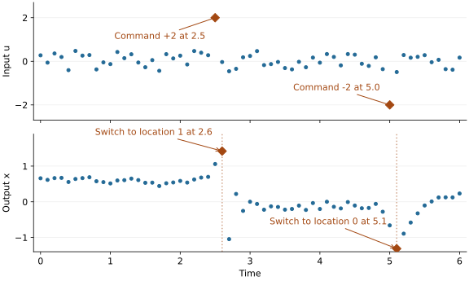

# Learning with Dainarx

This example learns a system that follows two different rules. An input command switches it from one location to the other. Dainarx receives the recorded inputs and outputs, but not the location labels. We then use the learned model to predict a new trace.

## Run the Example

From the repository root:

```bash
just examples-dainarx
```

The [example script](https://github.com/flowcean/flowcean/blob/main/examples/dainarx/run.py) generates its own noise-free data: four traces for learning and a fifth for prediction. Each trace contains time stamps in `time`, input values in `u`, and output values in `x`.

## The Example System

This is a synthetic system with one input and one output, observed every 0.1 time units. It starts in location 0. There, the previous output carries over with the same sign, and the output tends to settle near a positive value. In location 1, the previous output contributes with the opposite sign, so the output tends to alternate around a negative value. Both rules also use the current input.

Ordinary inputs vary randomly between -0.5 and 0.5; there is no added measurement noise. A `+2` command switches from location 0 to location 1, and a `-2` command switches back. The switch takes effect at the **next observation**, not at the command itself. At that observation, a separate rule makes the output jump; the new location's normal rule resumes on the observation after that.

[](../assets/dainarx/system-trace.svg){ target="\_blank" rel="noopener" }

The plot shows the first six time units of the fifth generated trace. Each dot is one observation. Orange diamonds mark input commands in the upper panel and the resulting switches in the lower panel. After the jump at 2.6, look for the alternating output; after the jump at 5.1, it starts moving back toward positive values.

Running the example also saves the plot to `examples/dainarx/outputs/system-trace.svg`.

## Learn from the Traces

Dainarx looks for changes in the traces and groups the parts that follow the same rule. It also learns when to switch locations and how the output changes at a switch.

The script passes the four training traces as separate Polars frames. That way, the final output of one trace is not used to predict the first output of another:

```python
from flowcean.hybrid.dainarx import fit_dainarx

fit = fit_dainarx(
    training,
    input_features=["u"],
    output_features=["x"],
    time_column="time",
    order=1,
    window=6,
    guard_kernel="linear",
    guard_c=1e4,
    guard_gamma="scale",
)
```

Here, `order=1` tells the model to predict each output from the previous output and the current input. With `window=6`, Dainarx examines six observations at a time to look for changes. The guard options control how it learns the conditions for switching locations.

## Predict a New Trace

The fifth trace was not used for learning. To start predicting it, we supply its first output, its starting location, and its input values:

```python
predicted = fit.model.rollout(
    held_out.select("time", "u"),
    output_history=held_out.select("x").head(1).to_numpy(),
    initial_location=fit.segments[0].location_id,
)
```

All traces in this example start in the same location, so we take its learned ID from the first training segment. For another dataset, you need to supply the starting location yourself.

After the first output, the model uses its own predictions to calculate each next output. It does not read the remaining recorded outputs. Those are kept for comparison. The returned frame contains the times, predicted outputs, and location IDs; it also includes the first output we supplied.

## Read the Results

The script prints the number of segments and learned locations, followed by the prediction error. You should see two locations. There are more segments: Dainarx splits each trace at the changes it detects, and several of those parts can belong to the same location.

The error is the root-mean-square error (RMSE) between the predicted and recorded outputs, excluding the first output used to start the prediction. This example has no noise and follows rules that the model can represent, so the error should be close to zero.

See the [API reference](../reference/hybrid.md#flowcean.hybrid.dainarx) for configuration options, including nonlinear terms. The method is described in the [Dainarx paper](https://arxiv.org/html/2507.16426v3).
