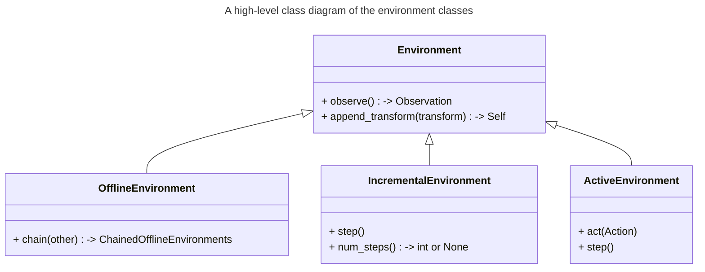

# Environment

Generally, there are three possible ways to retrieve data from a Cyber-Physical System:

- a pre-recorded dataset,
- a data stream from a simulation,
- a data stream from a real CPS.

Environments in Flowcean are a way to describe the possible data sources for the learning and evaluation procedure.
They are implemented via classes.
A high-level class diagram of the environment classes is provided below.

- **Offline Environment**: An offline environment has the ability to load a dataset.
  Data is pre-recorded (offline) and saved in a file or in a database.
  This data is all at once provided to the learning pipeline.
  This data is fixed and cannot be (meaningfully) changed.
  The offline environment provides the interface to a dataset but is not the dataset itself.
- **Incremental Environment**: An incremental environment has the ability to provide a stream of single data samples or batches of data.
  This could be provided by iterating over a dataset, by an interface to a simulation, or by a live interface to the real Cyber-Physical System.
  This is often referred to as _passive online learning_.
- **Active Environment**: An active environment has the ability to be influenced by the learning algorithm.
  This is done by receiving an _Action_.
  After an action is received the environment will evolve based on the action and the previous state.
  After a set time interval or a discrete step inside a simulation, the environment can be observed again.
  Examples are a controlled simulation or a controlled live experiment.

`Environment[Observation]` describes the type returned by `observe()`.
`ActiveEnvironment[Observation, Action]` also describes the type accepted by `act()`; these types need not be dataframes.

Apply [transforms](transform.md) in either of two ways:

- `environment.append_transform(transform)` mutates the environment and preserves its observation type and concrete class.
- `environment | transform` creates a new view and may change the observation type. The view retains offline, incremental, or active behavior, but not custom methods of the source's concrete class.

Views share their source's lifecycle; they are not independent copies or replayable streams.
Incremental environments signal exhaustion with `Finished`, and subsequent iteration remains exhausted unless the source supports an explicit reset.
Resetting a test generator also restores iteration through its existing transformed views.
Batch sizes must be positive.

Depending on the environment class, different [Learning Strategies](https://flowcean.me/user_guide/learning_strategies/) can be applied.
An active learning strategy, for example, can only be applied to an `ActiveEnvironment`.

For more information on the available classes and how environments are implemented in Flowcean, check out the [API](../reference/core.md).
